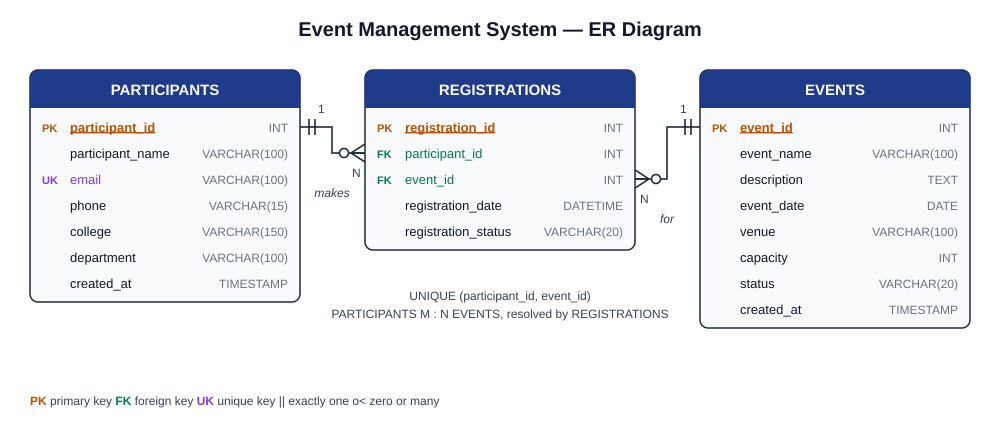
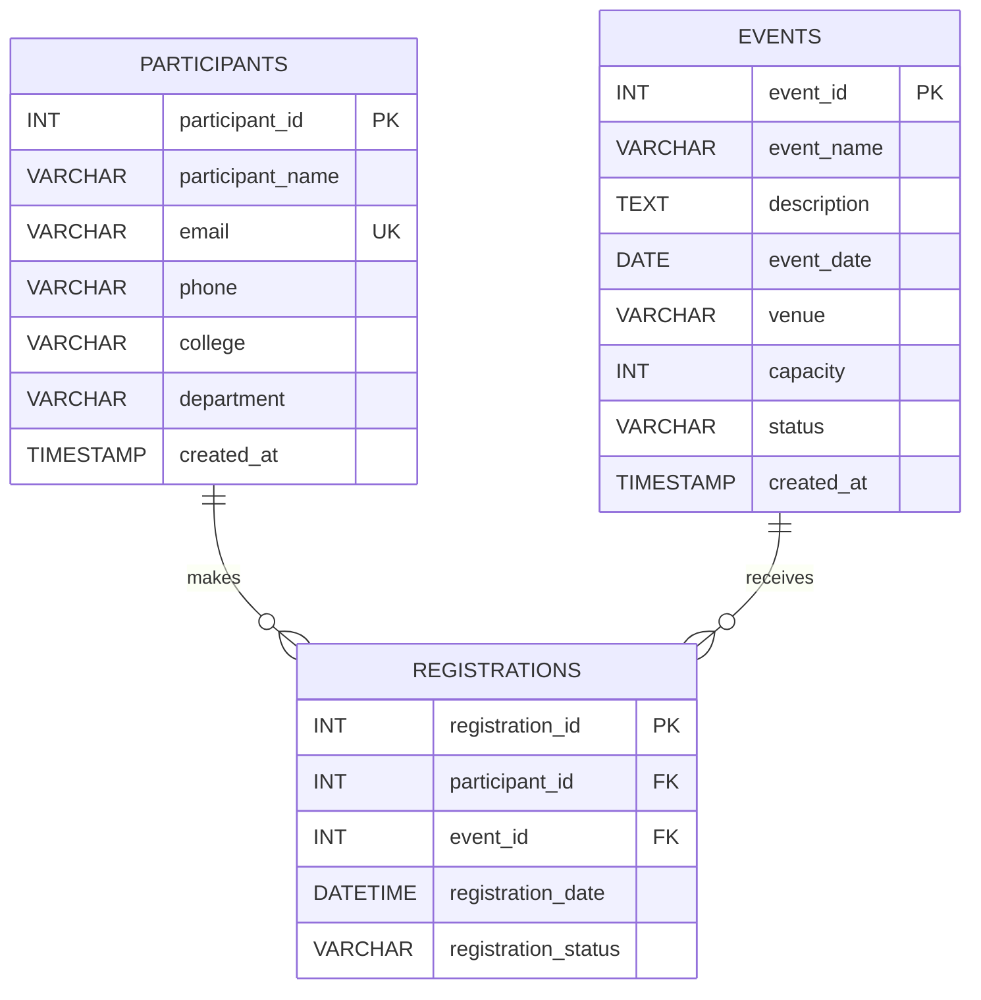

# Event Management System (MySQL + SQL + DBMS)

A database project that stores events and participants, registers participants
for events, stops duplicate and over-capacity registrations, and produces
reports with SQL. A simple, optional Flask web interface sits on top of the same
database.

| Document | What it contains |
|---|---|
| [docs/SETUP_GUIDE.md](docs/SETUP_GUIDE.md) | Installing MySQL on Windows, running every script, fixing common errors, running the web app |
| [docs/PROJECT_REPORT.md](docs/PROJECT_REPORT.md) | Full project report: abstract to references, normalization, test cases |
| [docs/VIVA_QA.md](docs/VIVA_QA.md) | Short viva questions and answers |
| [docs/er_diagram.svg](docs/er_diagram.svg) | ER diagram image for your report or slides |

---

## 1. Project architecture

```
 ┌──────────────────────────┐        ┌──────────────────────────┐
 │  MySQL Workbench         │        │  Web browser (optional)  │
 │  (you type SQL here)     │        │  http://127.0.0.1:5000   │
 └────────────┬─────────────┘        └────────────┬─────────────┘
              │ SQL                               │ HTTP
              │                        ┌──────────▼─────────────┐
              │                        │  Flask app (Python)    │
              │                        │  app.py + db.py        │
              │                        │  parameterized SQL     │
              │                        └──────────┬─────────────┘
              │                                   │ SQL
 ┌────────────▼───────────────────────────────────▼─────────────┐
 │  MySQL Server 8.4  -  database: event_management_db          │
 │  tables: events, participants, registrations                 │
 │  rules : PK, FK, UNIQUE, CHECK, NOT NULL, 3 triggers, 1 view │
 └──────────────────────────────────────────────────────────────┘
```

**The database is the heart of the project.** All rules (no duplicate email, no
duplicate registration, no over-booking) live inside MySQL, so they work the
same whether data comes from Workbench or the web app.

---

## 2. Tables and why we need three of them

| Table | Stores | Primary key | Foreign keys |
|---|---|---|---|
| `events` | Each event: name, description, date, venue, capacity, status | `event_id` | – |
| `participants` | Each person: name, email (unique), phone, college, department | `participant_id` | – |
| `registrations` | "Participant X registered for event Y" + date + status | `registration_id` | `participant_id` → participants, `event_id` → events |

**Why not just two tables?** One participant can join *many* events and one
event has *many* participants. That is a **many-to-many (M:N)** relationship.
A relational table cannot store a list inside one column (that would break 1NF),
so we add a **junction table**, `registrations`. Each row in it is one link.
The M:N relationship becomes two simple **one-to-many (1:N)** relationships:

- one participant → many registrations
- one event → many registrations

The registration row is also the natural place for facts that belong to *the
link itself*: when the person registered and whether the registration is
Confirmed, Cancelled or Attended.

---

## 3. ER diagram



The same diagram in Mermaid form (renders on GitHub and in VS Code with the
"Markdown Preview Mermaid Support" extension):



Reading the crow's-foot symbols: `||` = exactly one, `o{` = zero or many.
"One participant makes zero or many registrations; each registration belongs to
exactly one participant." Same for events.

---

## 4. Folder structure

```
event-management-system/
├── README.md                    <- you are here
├── sql/
│   ├── 01_schema.sql            <- database, tables, constraints, triggers, view
│   ├── 02_sample_data.sql       <- 8 events, 12 participants, 29 registrations
│   ├── 03_reports_queries.sql   <- 12 report queries with expected output
│   ├── 04_crud_operations.sql   <- INSERT / SELECT / UPDATE / DELETE demo
│   └── 05_constraint_tests.sql  <- 18 statements that MUST fail (proves integrity)
├── scripts/                     <- start_mysql.bat, stop_mysql.bat, reset_database.bat
├── web/                         <- optional Flask interface
│   ├── app.py, db.py
│   ├── requirements.txt, .env.example
│   ├── templates/  (10 HTML pages)
│   └── static/style.css
└── docs/
    ├── SETUP_GUIDE.md
    ├── PROJECT_REPORT.md
    ├── VIVA_QA.md
    └── er_diagram.svg
```

---

## 5. Stage-by-stage: what to run, where, and what you should see

All SQL files are run in **MySQL Workbench** (File → Open SQL Script…).
Full click-by-click instructions are in [docs/SETUP_GUIDE.md](docs/SETUP_GUIDE.md).

| Stage | File | How to run | You should see |
|---|---|---|---|
| 1 | `sql/01_schema.sql` | Execute all (⚡ / Ctrl+Shift+Enter) | `SHOW FULL TABLES` → 3 base tables + 1 view; `SHOW TRIGGERS` → 3 rows |
| 2 | `sql/02_sample_data.sql` | Execute all | Counts row: **8 · 12 · 29** |
| 3 | `sql/03_reports_queries.sql` | One query at a time (Ctrl+Enter) | Each result matches the comment under the query |
| 4 | `sql/04_crud_operations.sql` | Execute all, then read each result tab | Last result: **8 · 12 · 29** (demo rows cleaned up) |
| 5 | `sql/05_constraint_tests.sql` | One statement at a time (Ctrl+Enter) | Each one fails with the error shown in its comment |
| 6 (optional) | `web/` | PowerShell: see section 6 | Dashboard at http://127.0.0.1:5000 |

**Reset at any time:** run `01_schema.sql` then `02_sample_data.sql` again.
`01` begins with `DROP DATABASE IF EXISTS`, so it wipes everything and rebuilds
a clean database. Only ever do this on your own project database.

### How the important rules are enforced

| Rule | Mechanism | File |
|---|---|---|
| No duplicate participant email | `UNIQUE (email)` | 01 |
| No duplicate registration | `UNIQUE (participant_id, event_id)` | 01 |
| Registration must point to a real participant/event | `FOREIGN KEY` + `ON DELETE RESTRICT` | 01 |
| Capacity > 0, valid status, 10-digit phone, email shape | `CHECK` constraints | 01 |
| No registration beyond capacity | `BEFORE INSERT` / `BEFORE UPDATE` triggers | 01 |
| No registration for cancelled/completed events | same triggers | 01 |
| Capacity cannot be cut below seats already booked | `BEFORE UPDATE` trigger on events | 01 |

**Simultaneous registrations:** the insert trigger reads the event row with
`SELECT ... FOR UPDATE`. That puts a lock on that one event. If two people try to
take the last seat at the same instant, the second INSERT waits until the first
one finishes, then counts again, sees the event is full, and is rejected.
Different events do not block each other.

---

## 6. Optional web interface (Windows PowerShell, in VS Code)

```powershell
cd web
python -m venv .venv
.\.venv\Scripts\Activate.ps1
pip install -r requirements.txt
Copy-Item .env.example .env
notepad .env          # put your real MySQL password, save, close
python app.py
```

Open http://127.0.0.1:5000. Pages: Dashboard, Events (add/edit/view/delete,
search by name/venue/date), Participants (add/edit/search), Register, Summary.
Errors from MySQL (full event, duplicate email, ...) appear as red messages.
Details and troubleshooting: [docs/SETUP_GUIDE.md](docs/SETUP_GUIDE.md#part-c--optional-flask-web-interface).
